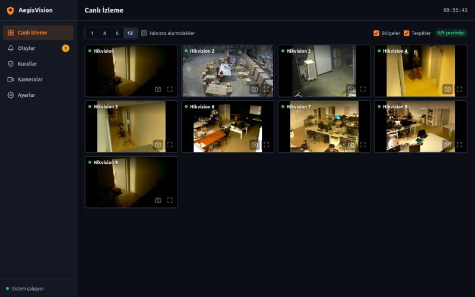
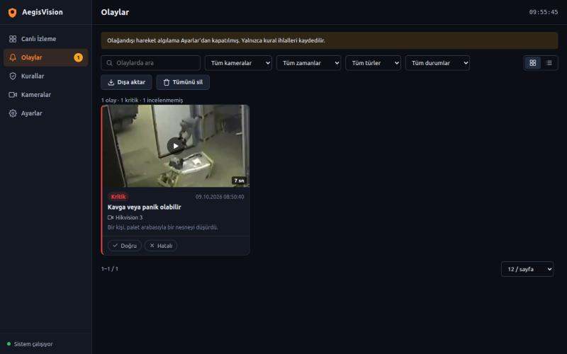
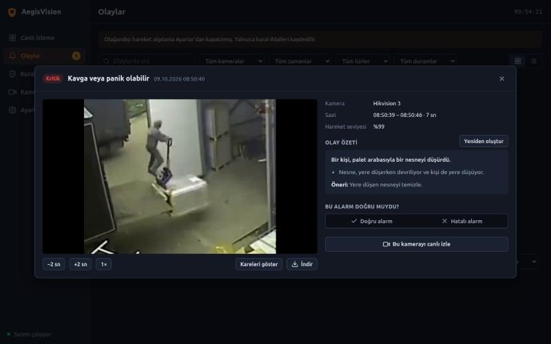
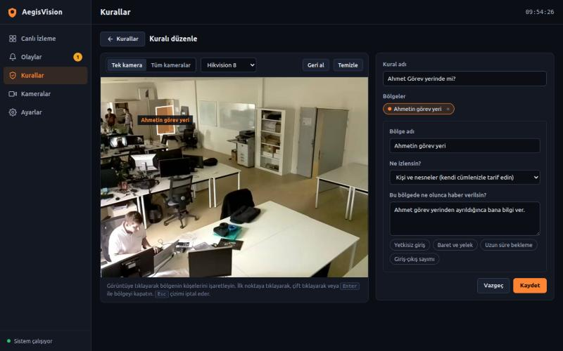
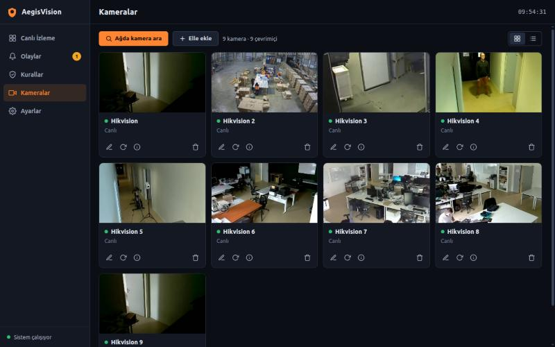
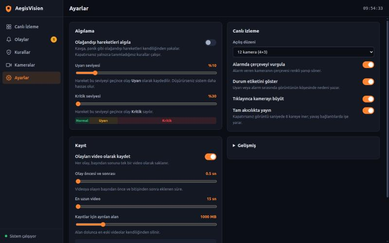

# AegisVision — Smart Surveillance System

**AegisVision turns ordinary IP cameras into an active security system.** It brings every camera into
one interface, detects unusual activity on its own, enforces safety rules written in plain language,
and records each incident as a complete, reviewable case: one continuous video, the key frame, a short
written summary and the operator's verdict.

Conventional camera systems record everything and understand nothing; someone has to watch the screens
or search hours of footage after the fact. AegisVision does the watching. Operators look only at what
needs their attention, and every alarm arrives with the evidence needed to act on it.

---

## Why it matters

| Capability | What it does | Why it matters |
| :--- | :--- | :--- |
| **Live monitoring** | 1 / 4 / 6 / 12-camera wall; a camera in alarm is outlined and labelled with the reason. | One operator can supervise many more cameras, because the system points at the one that needs attention. |
| **Unusual activity detection** | A video model scores every camera several times per second and flags fights, falls, panic, accidents — with no rules to configure. | Incidents nobody anticipated are still caught. It works from the moment a camera is added. |
| **Rules in plain language** | Draw a zone on the picture and write what should trigger an alert ("someone without a hard hat enters", "anyone enters between 22:00 and 06:00"), or pick from lists. | Site-specific safety and security policies become automatic checks without programming. The system states plainly when a request is beyond what a camera can observe, instead of silently doing something else. |
| **Working hours** | A rule can run only in a daily time window and on chosen weekdays — set in the form or read from the sentence. | Night-time intrusion rules stay quiet during the day; the largest source of nuisance alarms disappears. |
| **Object tracking** | Detections keep a stable identity from frame to frame; a violation must persist for one second before it counts. | One-frame false detections and a momentarily missed helmet no longer raise alarms; waiting time is measured per person. |
| **Obstruction monitoring** | Watches areas that must stay clear — emergency exits, fire hose cabinets — against a reference picture. | Blocked escape routes are a common, serious and easily overlooked hazard. |
| **Evidence-grade event records** | One continuous clip per incident, a snapshot of its peak, a short summary and the operator's true / false verdict. A violation that lasts an hour is one event with its real duration. | Every alarm can be verified in seconds, shared and audited later, without scrubbing through raw recordings. |
| **Reports** | Events by day, rule and camera; false-alarm rate; total violation time; printable. | Turns monitoring into measurable safety performance that managers and auditors can act on. |
| **Accuracy measurement** | A harness plays labelled videos to a private copy of the system and counts catches, misses and false alarms. | Every change to detection can be proven better or worse with numbers, not impressions. |

---

## Interface

| Live monitoring | Events |
| --- | --- |
|  |  |
| The camera wall; layout, zones and detection overlays are toggled from the top bar. | Recorded events with search, filters and one-tap true / false review. |

| Event window | Rule editor |
| --- | --- |
|  |  |
| The incident video, its short written summary and the operator's verdict. | Draw a zone on the camera picture and describe in plain language what should trigger an alert. |

| Cameras | Settings |
| --- | --- |
|  |  |
| Network discovery, manual addition, live status and editing. | Detection sensitivity, recording length, storage and appearance. |

The interface is in Turkish, works on phones as well as desktops, and offers a light theme (default),
a navy theme and a dark theme. Screenshots show test footage played through the camera simulator.

---

## Measured performance

The accuracy harness (`WebInterface/tests/accuracy_check.py`) was run on 75 labelled videos with the
installation's settings at the time (warning threshold 39, critical 40, incident merge time 1 s):

| Measure | Result |
| :--- | :--- |
| Videos containing an incident | **10 of 11 caught (91 %)**; the miss was a night-time traffic collision. |
| Footage without incidents (63 videos, 73 minutes) | **2 false alarms**, i.e. 1.6 per camera-hour. |
| A higher warning threshold (60) | Same 10 / 11 catches, **0 false alarms** on this set. |

These figures are a first, honest baseline rather than a guarantee: the labels are a draft, the set is
small (one video moves the catch rate by 9 points), the incident-free footage comes from a single office,
and the clips are collected footage rather than customer cameras. The full report, including what the
summaries got right and wrong, is in [docs/10](docs/10-gelistirme-ve-test.md#doğruluk-ölçümü).

---

## Architecture

```
Camera (RTSP) ──► camera_service ──► browser (live view over WebSocket)
                       │
                       ├─► anomaly_service ──► Triton: anomaly_detector ──► score ──► event
                       │
                       └─► live_detection_service ──► Triton: object detection ──► tracking ──► rule evaluation ──► event

Event ──► event_journal (persistent log) + evidence_store (clip, snapshot) + vlm_summarizer (short summary)
      ──► event_stream ──► every open browser page, instantly
```

| Component | Role | Why it matters |
| :--- | :--- | :--- |
| **Web interface & server** (`WebInterface/`) | FastAPI backend and a dependency-free browser interface. | The product itself: everything an operator sees and everything that ties the parts together. |
| **Inference server** (NVIDIA Triton) | Serves the anomaly model and three object detectors on the GPU, batched across cameras. | One GPU serves the whole camera fleet; models are swapped without touching the application. |
| **Unusual activity model** (`Anomaly_Detection/`) | A video model that has learned what normal activity looks like and flags the moments that deviate from it. | Catches incidents that no rule anticipated. Adapting it to a new site needs only video-level labels ("normal" / "abnormal"), never frame-by-frame annotation. |
| **Object detection** (`Object_Detection/`) | YOLOE open-vocabulary detector plus safety-equipment and general (COCO) detectors. | Lets a plain sentence name almost any object, while specialised models keep common checks precise. |
| **Rule engine** (`Rule_Generator_LLM/`) | Compiles sentences into deterministic detection plans, tracks objects, evaluates conditions, writes summaries. | Language is used only to *understand* the rule; the decision on every frame is deterministic and auditable. |
| **Camera simulator** (`Camera_System_Simulator/`) | Plays video files as real RTSP + ONVIF cameras. | The full system can be developed, demonstrated and tested without camera hardware. |

---

## Quick start

**Requirements:** Linux, an NVIDIA GPU, Docker with the NVIDIA Container Toolkit, Python 3.10 and ffmpeg.
Model files and detailed setup: [docs/02-kurulum.md](docs/02-kurulum.md).

```bash
conda create -p ./.conda python=3.10 -y && ./.conda/bin/pip install -r requirements.txt
```
```bash
cp .env.example .env        # optional: API key of the language-model service (rule compilation, summaries)
```
```bash
./Object_Detection/start_triton_docker.sh                        # 1. inference server
```
```bash
cd Camera_System_Simulator && ./start.sh --dir ../TestVideoSet   # 2. simulated cameras, if no real cameras are available
```
```bash
./WebInterface/run.sh                                            # 3. interface at http://localhost:8500
```

In the interface: **Kameralar → Ağda kamera ara → add the cameras**, then open **Canlı İzleme**.

---

## Documentation

The complete documentation lives in [`docs/`](docs/README.md) and is written in Turkish.

| Chapter | Content |
| :--- | :--- |
| [01 — Overview](docs/01-genel-bakis.md) | What the system does, its components, terminology |
| [02 — Installation](docs/02-kurulum.md) | Requirements, models, start-up and shutdown, ports |
| [03 — User guide](docs/03-kullanim-kilavuzu.md) | Every page of the interface, step by step |
| [04 — Architecture](docs/04-mimari.md) | Processes, threads, data flow, design decisions |
| [05 — Backend modules](docs/05-backend.md) | Reference for every module in `WebInterface/backend` |
| [06 — API reference](docs/06-api.md) | All HTTP, WebSocket and SSE endpoints with examples |
| [07 — Frontend](docs/07-frontend.md) | Structure, conventions, colour roles and themes |
| [08 — Rules and analysis](docs/08-kurallar-ve-analiz.md) | Rule compilation, tracking, condition types, event lifecycle, summaries |
| [09 — Data and configuration](docs/09-veri-ve-yapilandirma.md) | Files on disk, record formats, every setting, environment variables |
| [10 — Development and testing](docs/10-gelistirme-ve-test.md) | Workflow, system test, accuracy measurement, common changes |
| [11 — Troubleshooting](docs/11-sorun-giderme.md) | Symptoms, causes and fixes; known limitations |

---

## Repository layout

| Directory | Content |
| :--- | :--- |
| `WebInterface/` | **The product:** server (`backend/`), interface (`frontend/`), system test and accuracy harness (`tests/`). |
| `Rule_Generator_LLM/` | Rule compiler, plans from form choices, working hours, object tracker, condition evaluator, incident summarizer. |
| `Object_Detection/` | Object detection library and the Triton model repository. |
| `Anomaly_Detection/` | Training code of the unusual activity model (git submodule; not needed at run time). |
| `Camera_System_Simulator/` | Simulated RTSP + ONVIF cameras for development and demonstration. |
| `TestVideoSet/` | Sample videos for the simulator (not tracked in git). |
| `docs/` | Documentation and the screenshots used in this file. |

---

## Quality assurance

```bash
.conda/bin/python WebInterface/tests/system_check.py --sim-ip <this machine's IP address>
```

The system test starts an isolated server on its own port with temporary data and exercises the whole
interface and API — **134 checks**, from input validation and live video to tracking logic, working hours
and report figures. It never touches the running system and should be run after every change.

The same test runs on every push through GitHub Actions (`.github/workflows/ci.yml`). The CI machines have
no cameras or GPU, so the live-video section is skipped there and the remaining **112 checks** run.

```bash
.conda/bin/python WebInterface/tests/accuracy_check.py --no-summaries
```

The accuracy harness answers a different question — not *does it work* but *how well*. Run it before and
after any change to detection; see [docs/10](docs/10-gelistirme-ve-test.md#doğruluk-ölçümü).

`Object_Detection/run_tests.py` loads models and needs several gigabytes of GPU memory; do not run it while
the live system is serving.

---

## Data and privacy

- Video, events and settings stay on the server: analysis runs on the local GPU and all records are files
  in the data directory.
- The **only** external connection is the optional language-model service used to compile rule sentences
  and write incident summaries. When its key is set, a handful of small frames of each incident are sent
  to it. Without a key, rules can still be defined from lists and incidents are recorded without summaries.
- The system identifies no one: there is no face recognition and no number-plate reading, and the rule
  compiler says so when asked for it.

---

## Status and known limitations

AegisVision is a working pre-production system. Before it is installed on a customer network:

- **Authentication:** the interface and API have no login, roles or HTTPS yet; anyone on the network can
  use them. This is the first item of the next phase, together with alert notifications.
- **Credentials:** keys live only in the untracked `.env` file. A key used earlier **remains in git
  history** and must be rotated.
- **Storage:** records are JSON files built for a single server (atomic writes, directory lock); a
  multi-server installation needs a database.
- **Summary verdict:** the summaries' "real / ordinary" judgement is not reliable enough to suppress
  alarms (measured; see above). It is shown as information only.
- **Untested:** physical camera hardware, Firefox, continuous multi-day operation. Full list:
  [docs/11](docs/11-sorun-giderme.md#bilinen-sınırlar).
- **Long functions left as they are:** `Rule_Generator_LLM/compiler.py: _normalize_plan_data`
  (~230 lines), `live_detection_service.py: _process_camera` (~190 lines),
  `camera_service.py: probe_and_register` (~125 lines). They work; refactoring them is a separate task,
  because the first two can only be verified against real model output.
